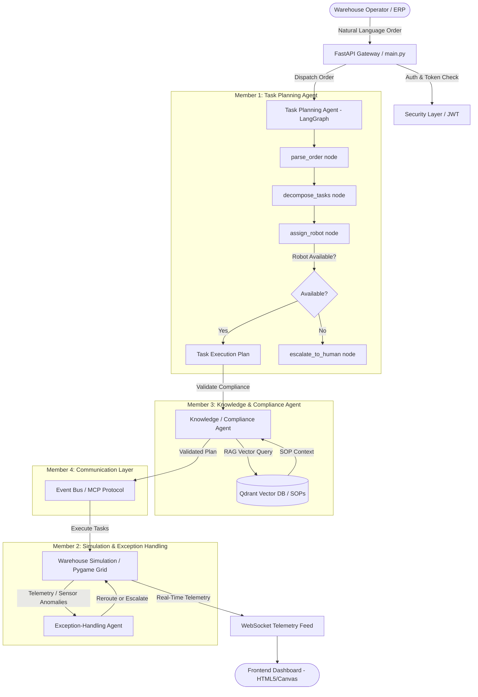

# WareFlow AI — Architecture Overview

## Multi-Agent System Architecture

## Module Separation & Team Boundaries

- **Member 1 (Task Planning Agent)**: Resides strictly in `agents/task_planning/`. Manages order understanding, task decomposition, and robot assignment graph.
- **Member 2 (Exception Handling & Simulation)**: Resides in `agents/exception_handling/` and `simulation/`. Manages real-time robot operations, path recalculation, anomaly responses, and fake sensor generation.
- **Member 3 (Knowledge & Compliance Agent)**: Resides in `agents/knowledge_compliance/` and `data/`. Manages vector embeddings, SOP documents, and safety rule checking.
- **Member 4 (Integration, Security & Dashboard)**: Resides in `communication/`, `security/`, `dashboard/`, and `main.py`. Connects all modules into a functional system.
